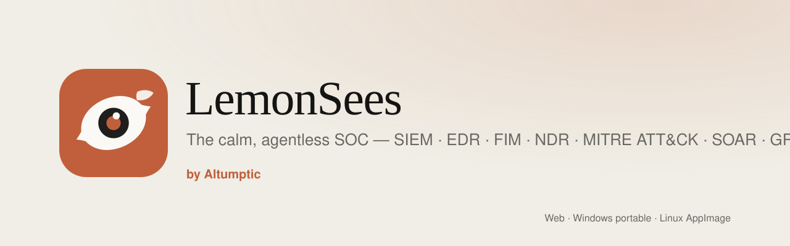
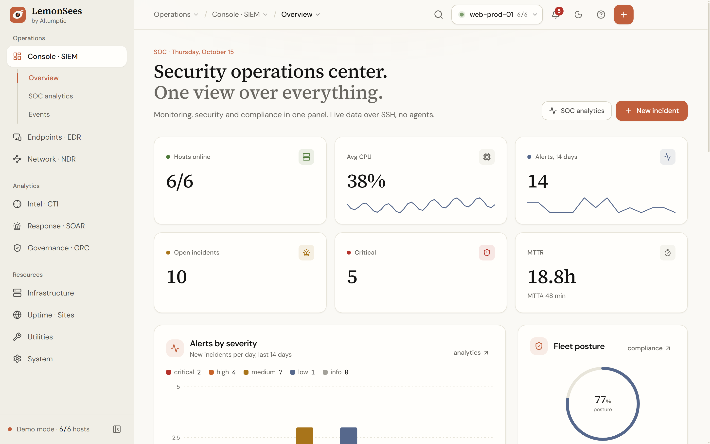
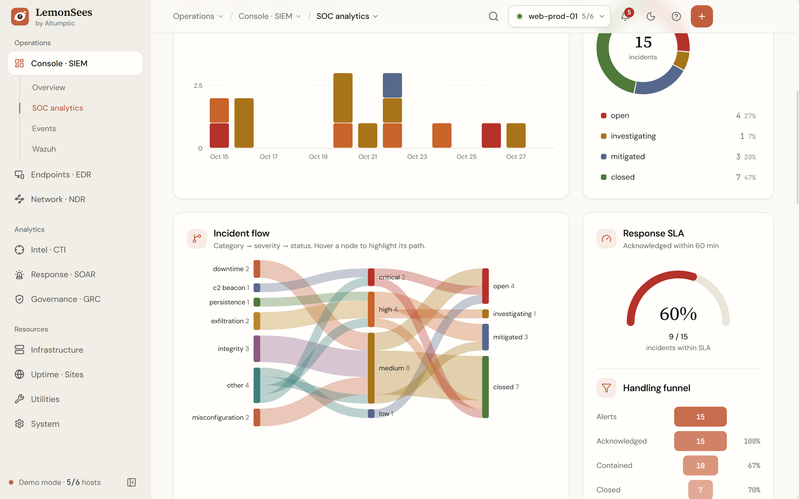
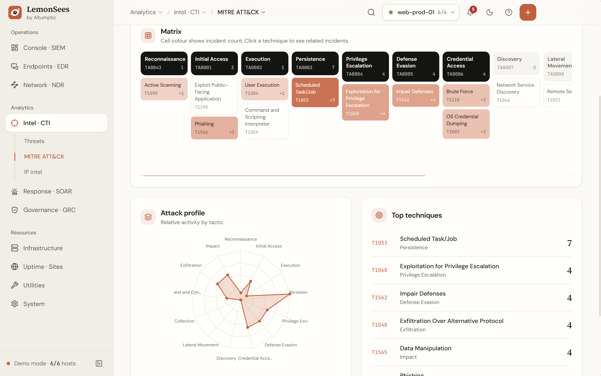
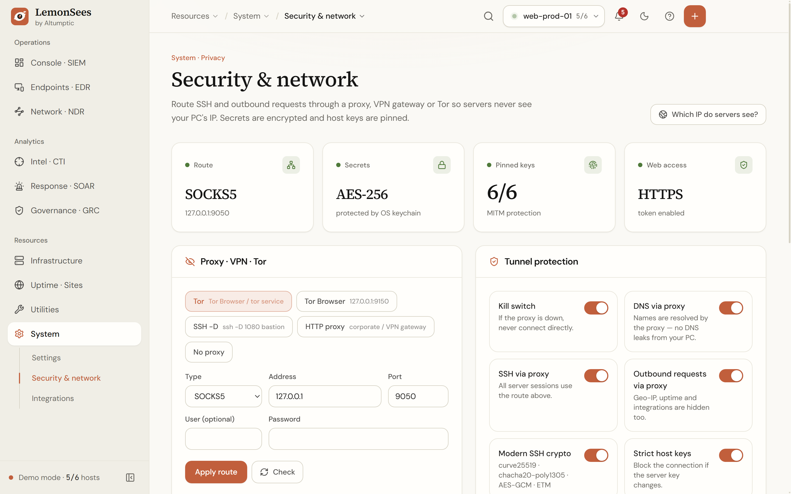
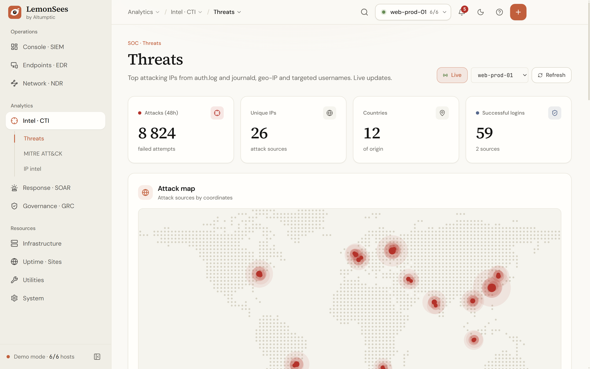
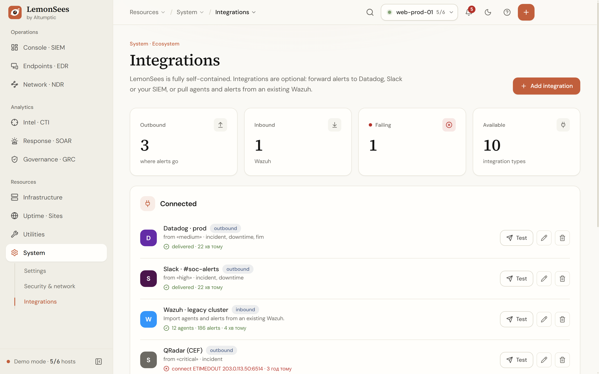
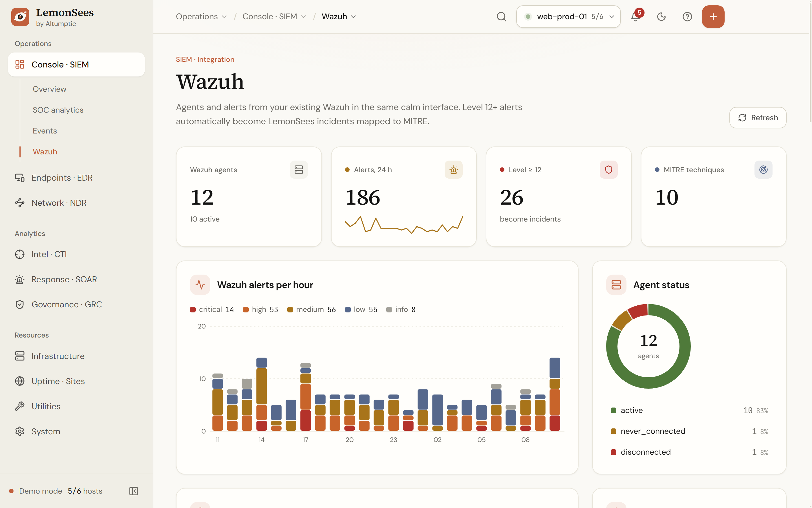
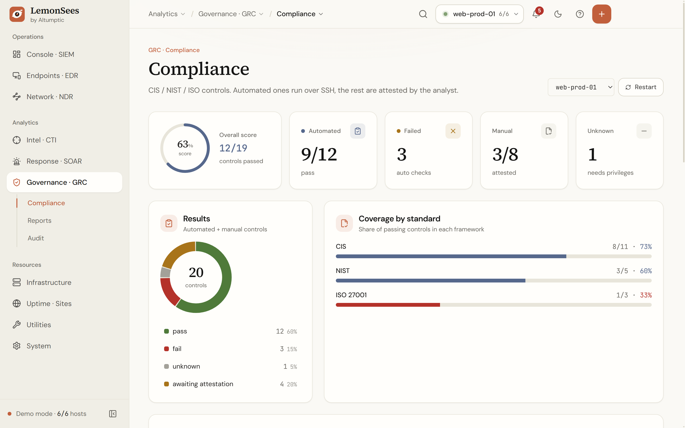
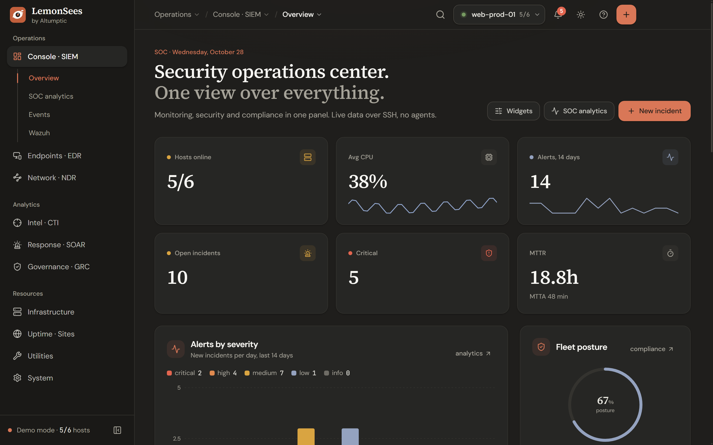

<div align="center">



# LemonSees

**A calm, agentless SOC console for Linux fleets — by [Altumptic](https://altumptic.com)**

SIEM · EDR · file integrity · NDR · threat intel with MITRE ATT&CK · SOAR · GRC — over plain SSH.<br/>
Self-hosted web app, portable Windows `.exe`, or Linux AppImage.

`PSB-B` · `SIGNED (Sigstore)` · `ATTESTED` · `SBOM` · `NO-TELEMETRY` · `LOCAL-FIRST` · `FAIL-CLOSED` · `TOR-CAPABLE` · `AUDIT:NONE` · `DISCLOSURE:OK`

[Download](https://github.com/Altumptic/LemonSees/releases/latest) · [Try the demo](#-try-it-in-30-seconds) · [Install](#-install) · [Verify a release](docs/security/VERIFY.md) · [Security notes](docs/security/SECURITY-NOTES.md)

<br/>



</div>

---

## What it is

LemonSees connects to your Linux servers over SSH and turns what it reads — metrics, processes, sockets, logins, cron and
services, file hashes, configuration — into a security console: live risk, incidents, MITRE ATT&CK mapping, compliance
evidence and uptime. Nothing has to be installed on the servers. Everything runs on your machine or your own server; no
data is sent to Altumptic.

## Highlights

- **SOC analytics** — alert volume by severity, MTTA / MTTR, response-SLA gauge, handling funnel, Sankey incident flow,
  day×hour heatmap, half-year activity calendar, most affected hosts, analyst workload.
- **MITRE ATT&CK** — incidents are mapped to tactics and techniques (keyword heuristic; Wazuh alerts keep Wazuh's IDs).
- **File integrity (FIM)** — SHA-256 + mode/owner of `/etc/shadow`, `sudoers`, `sshd_config`, `authorized_keys`, cron,
  systemd units…; checked on every sweep (default 5 min); drift opens an incident.
- **Detection rules** — your own regex + threshold + time window over journald or any log file, with MITRE technique,
  severity and host scope; templates and a live *test on host*.
- **Threat intel** — brute-force sources on a world map (geo-IP is opt-in), targeted usernames, IP investigation.
- **EDR / NDR** — processes, persistence, posture with a hardening radar, configuration vulnerabilities with
  remediation, live traffic and sockets.
- **SOAR & GRC** — incident register with timeline, auto-incidents, playbooks; CIS / NIST / ISO 27001 / GDPR control
  subset with human attestations, reports and an audit log.
- **Privacy routing** — SSH and every outbound call via **Tor / SOCKS5 / HTTP proxy** or a **bastion**, globally or per
  host, with a **kill switch**, DNS through the proxy and a *“Which IP do servers see?”* check.
- **Encryption** — secrets encrypted at rest with AES-256-GCM, key in the OS keychain; encrypted backups; HTTPS for web mode.
- **Integrations (optional)** — out: Datadog, Slack, Microsoft Teams, Telegram, HMAC-signed webhooks, Splunk HEC,
  Elastic/OpenSearch, Syslog CEF, PagerDuty. In: **Wazuh** agents and alerts.
- **Optional agent** — one read-only `sh` script, no root, pull (over SSH) or push (HTTPS + per-agent token).
- **Comfortable** — clickable breadcrumbs, global host switcher, alerts inbox, <kbd>Ctrl</kbd>+<kbd>K</kbd> palette,
  `g`-shortcuts, customisable overview, Ivory & Graphite themes, 80–150 % UI scale, EN · UK · RU · PL · ZH.

<table>
<tr>
<td width="50%"><br/><sub><b>SOC analytics</b> — Sankey flow, SLA gauge, funnel</sub></td>
<td width="50%"><br/><sub><b>MITRE ATT&CK</b> matrix</sub></td>
</tr>
<tr>
<td><br/><sub><b>Security &amp; network</b> — Tor/proxy, kill switch, pinned keys</sub></td>
<td><br/><sub><b>Threat intel</b> — attack sources</sub></td>
</tr>
<tr>
<td><br/><sub><b>Integrations</b> — Datadog, Slack, Wazuh, SIEMs</sub></td>
<td><br/><sub><b>Wazuh</b> agents and alerts</sub></td>
</tr>
<tr>
<td><br/><sub><b>Compliance</b> evidence</sub></td>
<td><br/><sub><b>Graphite</b> theme</sub></td>
</tr>
</table>

## LemonSees and Wazuh — an honest comparison

LemonSees is not a drop-in replacement for Wazuh. It optimises for **zero install on targets, privacy and a calm UI** for
small and medium Linux fleets, and it can sit **next to** an existing Wazuh.

| | LemonSees | Wazuh |
|---|---|---|
| On the monitored servers | nothing by default (SSH); optional sh agent | Wazuh agent on every endpoint |
| Endpoints | Linux with a POSIX shell | Linux, Windows, macOS, more |
| FIM | periodic SHA-256 sweep (default 5 min) | real-time (inotify / whodata) |
| Detection content | built-in checks + your regex rules | large decoder/rule set maintained by Wazuh |
| Active response | no (detect & report) | yes |
| Scale | tens to low hundreds of hosts | thousands of agents with indexer cluster |
| Analyst privacy | Tor / proxy / bastion, kill switch, DNS via proxy | not a focus |
| Deployment | single process: web, portable `.exe`, AppImage, Docker | manager + indexer + dashboard |
| Use together | imports Wazuh agents and alerts (level 12+ → incidents) | — |

## ⚡ Try it in 30 seconds

Open LemonSees and click **Try the demo** (or *Settings → Demo mode*): six realistic hosts, a month of incidents, attacks,
FIM drift, Wazuh data and agents — all generated locally; demo IPs come from documentation ranges (RFC 5737).

## 📦 Install

| Platform | Get it | Notes |
|---|---|---|
| **Windows** | `LemonSees-<v>-portable.exe` (or `.zip`) | No installer, no admin rights. Data in `LemonSees-data/` next to the exe. Not Authenticode-signed — [verify](docs/security/VERIFY.md). |
| **Linux** | `LemonSees-<v>-x86_64.AppImage` (or `.tar.gz`) | `chmod +x` and run. Create `LemonSees-data/` next to it for fully portable mode. |
| **Web** | `LemonSees-<v>-web.tar.gz` or `git clone` | Node.js 22.12+: `npm ci && npm run build && npm start` → <http://127.0.0.1:5199> |
| **Docker** | `docker build -t lemonsees .` | See below. |

Every release ships `SHA256SUMS`, a Sigstore signature, GitHub build provenance and an SBOM — see
[docs/security/VERIFY.md](docs/security/VERIFY.md).

### Web mode on a network

LemonSees refuses to listen on a public interface without an access token:

```bash
LEMONSEES_HOST=0.0.0.0 \
LEMONSEES_TOKEN="$(openssl rand -hex 24)" \
LEMONSEES_MASTER_KEY="a long passphrase for the secret vault" \
LEMONSEES_TLS=self \
npm start
```

### Docker

```bash
docker build -t lemonsees .
docker run -d --name lemonsees -p 5199:5199 \
  -e LEMONSEES_TOKEN="$(openssl rand -hex 24)" \
  -e LEMONSEES_MASTER_KEY="a long passphrase" \
  -e LEMONSEES_TLS=self \
  -v lemonsees-data:/data lemonsees
```

| Variable | Default | Purpose |
|---|---|---|
| `LEMONSEES_HOST` | `127.0.0.1` | Bind address. Non-loopback requires a token. |
| `LEMONSEES_PORT` | `5199` | HTTP(S) / WebSocket port |
| `LEMONSEES_TOKEN` | — | Access token for the web UI and API |
| `LEMONSEES_ALLOWED_HOSTS` | — | Comma-separated host names accepted in web mode (DNS-rebinding defence) |
| `LEMONSEES_TLS` | — | `self` → HTTPS with an auto-generated self-signed certificate |
| `LEMONSEES_TLS_CERT` / `LEMONSEES_TLS_KEY` | — | Your own certificate and key |
| `LEMONSEES_MASTER_KEY` | — | Passphrase for the secret vault (recommended on servers) |
| `LEMONSEES_SECURE_COOKIE` | — | `1` behind a TLS-terminating reverse proxy |
| `SHOK_CONFIG_DIR` | `./config` | Data directory |

## 🕶️ Keep your IP private

1. Start Tor (or your VPN, or `ssh -D 1080 bastion`).
2. *System → Security & network* → **Tor** preset (SOCKS5 `127.0.0.1:9050`) → **Apply route**.
3. Keep **Kill switch** and **DNS via proxy** on, press **Which IP do servers see?** — it should show the exit IP.

Per-host routes (own proxy or **bastion**) are in the host form under *Route & privacy*. This hides your IP from servers
and services; it is not a guarantee of anonymity — see the [threat model](docs/security/THREAT-MODEL.md).

## 🔌 Works with what you already run — optional

LemonSees needs no external API. When you want it: *System → Integrations*.

- **Wazuh** — manager API (`https://manager:55000`) and optionally the indexer (`https://indexer:9200`); agents and alerts
  appear under *Console → Wazuh*, level 12+ alerts become incidents.
- **Datadog** — API key + site (e.g. `datadoghq.eu`); incidents, downtime and FIM drift arrive as Events and Logs.
- Slack, Teams, Telegram, webhooks, Splunk, Elastic, Syslog CEF, PagerDuty — each with a severity / event filter and a **Test** button.

## 🚀 Quick start

1. Top bar **+** → *Host (SSH)*: address, a dedicated non-root user and an SSH key.
2. Watch *Overview* fill with live metrics, risk and alerts.
3. *Endpoints → File integrity*: the first scan becomes the baseline.
4. *Response → Detection rules*: add a template, test it on a host.

Keyboard: <kbd>Ctrl</kbd>+<kbd>K</kbd> search · <kbd>Ctrl</kbd>+<kbd>B</kbd> sidebar · <kbd>?</kbd> shortcuts · <kbd>g</kbd> <kbd>o</kbd> overview · <kbd>g</kbd> <kbd>i</kbd> incidents · <kbd>g</kbd> <kbd>m</kbd> MITRE.

## 🔐 Security

Altumptic Product Security Baseline class **PSB-B**. Read before deploying:

- [Security design notes](docs/security/SECURITY-NOTES.md) — trust boundaries, cryptography, data inventory, known limits
- [Threat model & non-goals](docs/security/THREAT-MODEL.md)
- [Verify a release](docs/security/VERIFY.md)
- [Vulnerability disclosure](SECURITY.md) — `/.well-known/security.txt`, PGP `117B A978 F332 80B5 12EE 84B5 D278 3C4F DE43 0CA6`

Labels mean exactly this: **SIGNED** — release checksums signed with Sigstore by this repo's release workflow (binaries
are not Authenticode-signed). **ATTESTED** — GitHub build provenance. **SBOM** — CycloneDX attached. **NO-TELEMETRY** —
no analytics, nothing sent to Altumptic. **LOCAL-FIRST** — core features never upload your data. **FAIL-CLOSED** — kill
switch, host-key pinning, tamper-evident encryption. **TOR-CAPABLE** — supported, not on by default. **AUDIT:NONE** — no
independent audit yet.

## 🛠️ Development

```bash
npm ci
npm run server      # engine on :5199
npm run dev         # UI on :5198 (proxies /api and /ws)
npm test            # security tests: fail-closed, crypto, authZ, input parsing
npm run typecheck
npm run dist:win    # portable .exe + zip
npm run dist:linux  # AppImage + tar.gz
```

Design system: [DESIGN.md](DESIGN.md) · Changes: [CHANGELOG.md](CHANGELOG.md) · Contributors: [CONTRIBUTORS.md](CONTRIBUTORS.md)

## License

[MIT](LICENSE) © 2026 [Altumptic](https://altumptic.com) and LemonSees contributors.
