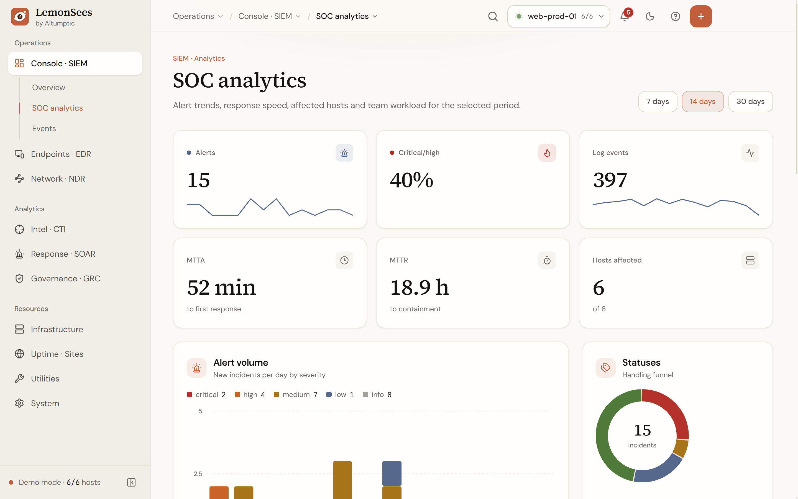
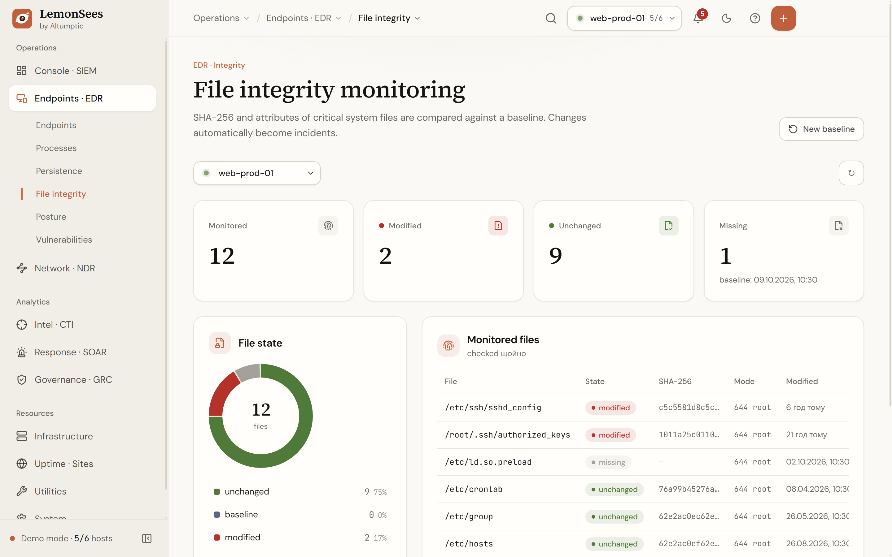

<div align="center">


# LemonSees

**The calm, agentless SOC — by [Altumptic](https://altumptic.com)**

SIEM · EDR · File Integrity · NDR · Threat Intel with MITRE ATT&CK · SOAR · GRC — over plain SSH.<br/>
Runs as a **self-hosted web app**, a **portable Windows `.exe`** or a **Linux AppImage**.

[](https://github.com/Altumptic/LemonSees/releases)
[](LICENSE)
[](#-install)
[](SECURITY.md)

[Download](https://github.com/Altumptic/LemonSees/releases/latest) · [Try the demo](#-try-it-in-30-seconds) · [Install](#-install) · [Security](SECURITY.md)

<br/>


</div>

---

## Why LemonSees

Wazuh, Security Onion and friends are powerful — and heavy: agents on every host, an indexer cluster,
a dashboard stack, days of tuning. **LemonSees treats the SSH session as the agent.** Point it at a
server and within seconds you have live telemetry, threat intel, integrity monitoring, incidents and
compliance — in an interface that stays quiet until something actually needs you.

|  | **LemonSees** | Typical agent-based SIEM |
|---|---|---|
| Install on servers | **Nothing** — SSH key is enough | Agent per host + manager + indexer |
| Time to first insight | **Seconds** | Hours to days |
| Footprint | One Node.js process (~100 MB) | Multi-node cluster, GBs of RAM |
| Deployment | Web app · portable `.exe` · AppImage · Docker | Server cluster |
| MITRE ATT&CK mapping | **Built in**, automatic | Rules / add-ons |
| File integrity (FIM) | **SHA-256 baselines over SSH** | Agent syscheck |
| Compliance (CIS · NIST · ISO 27001 · GDPR) | **Automated + attested** with reports | Varies |
| Interface | Calm, readable, scales 80–150 % | Data-dense dashboards |

## ✨ Highlights

- **SOC analytics** — alert volume by severity, MTTA / MTTR, activity heatmap (day × hour), most affected hosts, analyst workload.
- **MITRE ATT&CK matrix** — every incident is mapped to tactics & techniques automatically; click a cell to drill into incidents.
- **File integrity monitoring** — SHA-256 + mode/owner of `/etc/shadow`, `sudoers`, `sshd_config`, `authorized_keys`, cron, systemd units…; drift opens an incident.
- **Threat intel** — brute-force sources with geo-IP on a world map, targeted usernames, successful logins to double-check, IP investigation (rDNS, WHOIS, reputation).
- **EDR** — processes, persistence (cron / services / timers / rc), security posture with a hardening radar, configuration vulnerabilities with remediation.
- **NDR** — live traffic, TCP states, listening sockets, top peers.
- **SOAR** — incident register with timeline, auto-incidents (SSH brute force, FIM drift), playbooks.
- **GRC** — CIS / NIST / ISO 27001 / GDPR controls, human attestations, coverage by framework, printable reports, immutable audit log with CSV export.
- **Infrastructure** — hosts, metrics history, Docker containers / networks / volumes, uptime monitors and a public status board, SSH terminal, 39 database engines.
- **Built for people** — functional top bar (clickable breadcrumbs, global host switcher, alerts inbox, quick create), <kbd>Ctrl</kbd>+<kbd>K</kbd> command palette, `g`-shortcuts, five languages (EN · UK · RU · PL · ZH), Ivory & Graphite themes, UI scale presets.

<table>
<tr>
<td width="50%"><br/><sub><b>SOC analytics</b> — trends, response times, heatmap</sub></td>
<td width="50%"><br/><sub><b>MITRE ATT&CK</b> — automatic technique mapping</sub></td>
</tr>
<tr>
<td><br/><sub><b>Threat intel</b> — attack sources on a world map</sub></td>
<td><br/><sub><b>Compliance</b> — CIS · NIST · ISO 27001 · GDPR</sub></td>
</tr>
<tr>
<td><br/><sub><b>File integrity</b> — baselines and drift</sub></td>
<td><br/><sub><b>Graphite</b> dark theme</sub></td>
</tr>
</table>

## ⚡ Try it in 30 seconds

No servers needed: open LemonSees and click **Try the demo** (or **Settings → Demo mode**).
You get six realistic hosts, a month of incidents, attacks from around the world, FIM drift and
compliance results — everything is generated locally; demo IPs come from documentation ranges (RFC 5737).

## 📦 Install

### Windows — portable

Download `LemonSees-<version>-portable.exe` from [Releases](https://github.com/Altumptic/LemonSees/releases/latest) and run it.
No installer, no admin rights. Data is stored next to the `.exe` in `LemonSees-data/`, so you can carry it on a USB stick.
A `.zip` build is also published.

### Linux — AppImage

```bash
chmod +x LemonSees-*-x86_64.AppImage
./LemonSees-*-x86_64.AppImage
```

Settings live in `~/.config/LemonSees`. To make it fully portable, create a `LemonSees-data/` folder next to the AppImage.
A `.tar.gz` build is also published.

### Web — any OS with Node.js 22+

```bash
git clone https://github.com/Altumptic/LemonSees.git && cd LemonSees
npm ci && npm run build
npm start                      # → http://127.0.0.1:5199
```

On Windows you can double-click `LemonSees.bat`; on Linux/macOS run `./lemonsees.sh`.

**Serving on a network** requires an access token — LemonSees refuses to bind to a public interface without one:

```bash
LEMONSEES_HOST=0.0.0.0 LEMONSEES_TOKEN="$(openssl rand -hex 24)" npm start
```

Put it behind TLS (nginx, Caddy, Traefik) and set `LEMONSEES_SECURE_COOKIE=1`.

### Docker

```bash
docker build -t lemonsees .
docker run -d --name lemonsees -p 5199:5199 \
  -e LEMONSEES_TOKEN="$(openssl rand -hex 24)" \
  -v lemonsees-data:/data lemonsees
```

| Variable | Default | Purpose |
|---|---|---|
| `LEMONSEES_HOST` | `127.0.0.1` | Bind address. Non-loopback requires a token. |
| `LEMONSEES_PORT` | `5199` | HTTP / WebSocket port |
| `LEMONSEES_TOKEN` | — | Access token for the web UI and API (sessions are HttpOnly cookies) |
| `LEMONSEES_SECURE_COOKIE` | — | `1` to mark the session cookie `Secure` behind HTTPS |
| `SHOK_CONFIG_DIR` | `./config` | Where hosts, incidents, baselines and audit are stored |

## 🚀 Quick start

1. **Add a host** — top bar **+** → *Host (SSH)*: address, user and an SSH key (passwords work too).
2. Watch **Overview** fill with live metrics, risk and alerts.
3. Open **Endpoints → File integrity** — the first scan becomes the baseline; later drift raises an incident.
4. Check **Intel → Threats** and **MITRE ATT&CK**, then run **Governance → Compliance** and export a report.

Keyboard: <kbd>Ctrl</kbd>+<kbd>K</kbd> search · <kbd>Ctrl</kbd>+<kbd>B</kbd> sidebar · <kbd>?</kbd> all shortcuts · <kbd>g</kbd> <kbd>o</kbd> overview · <kbd>g</kbd> <kbd>i</kbd> incidents · <kbd>g</kbd> <kbd>m</kbd> MITRE.

## 🏗️ Architecture

```
┌──────────── Browser · Electron (Windows / Linux) ────────────┐
│  React UI — lazy-loaded pages, SVG charts, demo engine        │
└───────────────┬──────────────────────────────────────────────┘
                │ HTTP + WebSocket (token-protected in web mode)
┌───────────────┴──────────────────────────────────────────────┐
│  LemonSees engine (Node.js)                                   │
│  collectors · threat sweep · FIM · uptime · incidents · audit │
└───────────────┬──────────────────────────────────────────────┘
                │ SSH — the session is the agent
        ┌───────┴────────┐
        │ Linux servers   │  /proc · ps · ss · cron · systemd · auth.log · docker · sha256sum
        └────────────────┘
```

- One multiplexed SSH connection per host; metrics are collected in a single round-trip per poll.
- Nothing runs on your servers between polls; credentials never leave the machine running LemonSees.
- Every page is its own chunk and warms up in the background; live state uses `useSyncExternalStore`, identical frames are dropped.

## 🛠️ Development

```bash
npm ci
npm run server      # engine on :5199
npm run dev         # UI on :5198 with hot reload (proxies /api and /ws)
npm run app         # Electron shell
npm run typecheck
npm run dist:win    # portable .exe + zip   → release/
npm run dist:linux  # AppImage + tar.gz     → release/
npm run assets      # regenerate PNG icons from public/logo.svg
npm run shots       # regenerate README screenshots from the demo (needs npm run dev)
```

Tagging `v*` builds Windows, Linux and web bundles in GitHub Actions and attaches them to a release.
Design tokens and rules live in [DESIGN.md](DESIGN.md).

## 🔐 Security

LemonSees is a security tool, so its own security matters. Please report vulnerabilities privately —
see **[SECURITY.md](SECURITY.md)**. Every instance also serves the Altumptic contact at `/.well-known/security.txt`.

| | |
|---|---|
| PGP key | [`/.well-known/pgp-key.txt`](https://altumptic.com/.well-known/pgp-key.txt) |
| Fingerprint | `117B A978 F332 80B5 12EE 84B5 D278 3C4F DE43 0CA6` |
| Key type | Ed25519 / Cv25519 · expires 13 Oct 2028 |
| Machine-readable | [`/.well-known/security.txt`](https://altumptic.com/.well-known/security.txt) |

## 🤝 Contributing

Issues and pull requests are welcome — see [CONTRIBUTORS.md](CONTRIBUTORS.md). Please run `npm run typecheck && npm run build` before opening a PR.

## 📄 License

[MIT](LICENSE) © 2026 [Altumptic](https://altumptic.com) and LemonSees contributors.
